<!-- ═══════════════ Banner ═══════════════ -->

  

<!-- ═══════════════ Greeting ═══════════════ -->
<h1>
  
  
</h1>

  

  

  

  

  

  

 

<!-- ═══════════════ Tools ═══════════════ -->
<h1>
   Tools & Technology
</h1>

<table align="center">
  <tr>
    <td align="center" width="100">
      
       Python
    </td>
    <td align="center" width="100">
      
       Django
    </td>
    <td align="center" width="100">
      
       FastAPI
    </td>
    <td align="center" width="100">
      
       PostgreSQL
    </td>
    <td align="center" width="100">
      
       Redis
    </td>
    <td align="center" width="100">
      
       Celery
    </td>
    <td align="center" width="100">
      
       Docker
    </td>
    <td align="center" width="100">
      
       Git
    </td>
  </tr>
  <tr>
    <td align="center" width="100">
      
       GitHub
    </td>
    <td align="center" width="100">
      
       AWS
    </td>
    <td align="center" width="100">
      
       Vue.js
    </td>
    <td align="center" width="100">
      
       JavaScript
    </td>
    <td align="center" width="100">
      
       HTML5
    </td>
    <td align="center" width="100">
      
       CSS3
    </td>
    <td align="center" width="100">
      
       PyCharm
    </td>
    <td align="center" width="100">
      
       Postman
    </td>
  </tr>
</table>

  

<!-- ═══════════════ Projects ═══════════════ -->
<h1> Projects</h1>

<table align="center">
  <tr>
    <td align="center" valign="top">
      
    </td>
    <td align="center" valign="top">
      
    </td>
    <td align="center" valign="top">
      
    </td>
  </tr>
</table>
